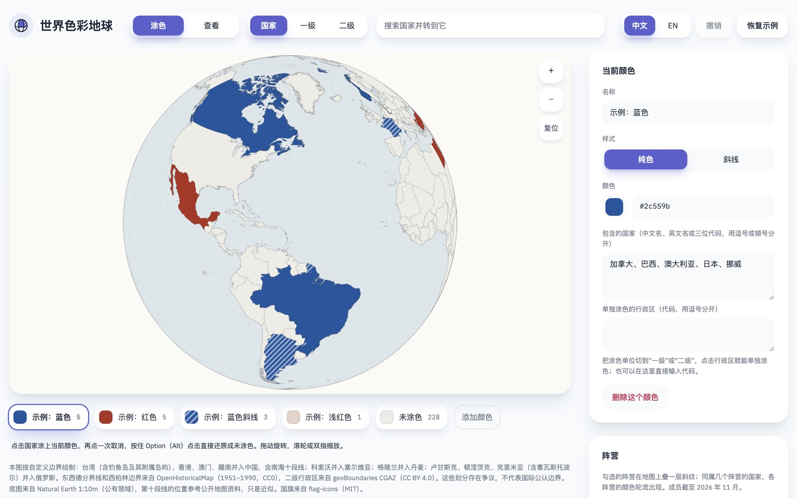
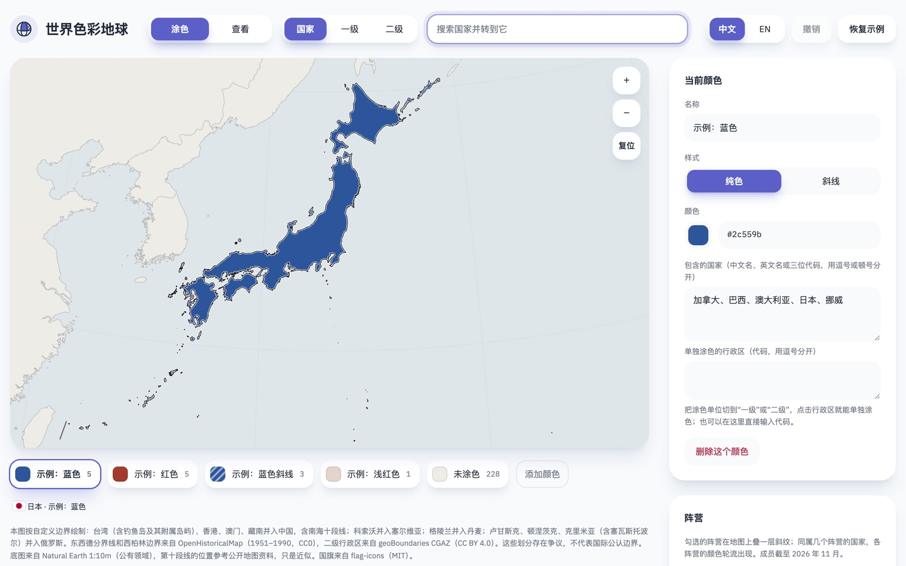
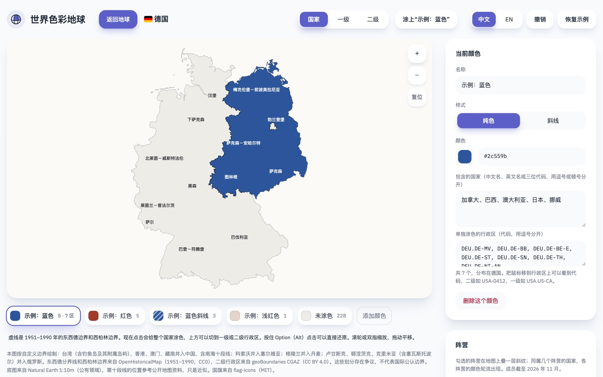
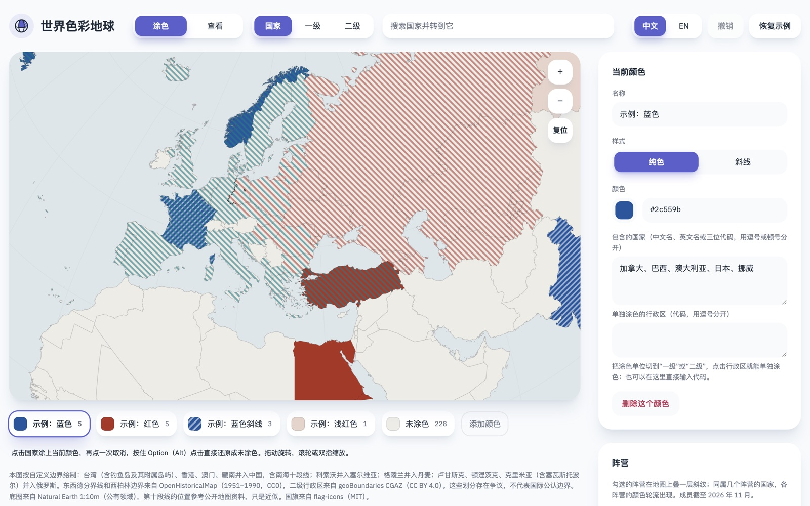
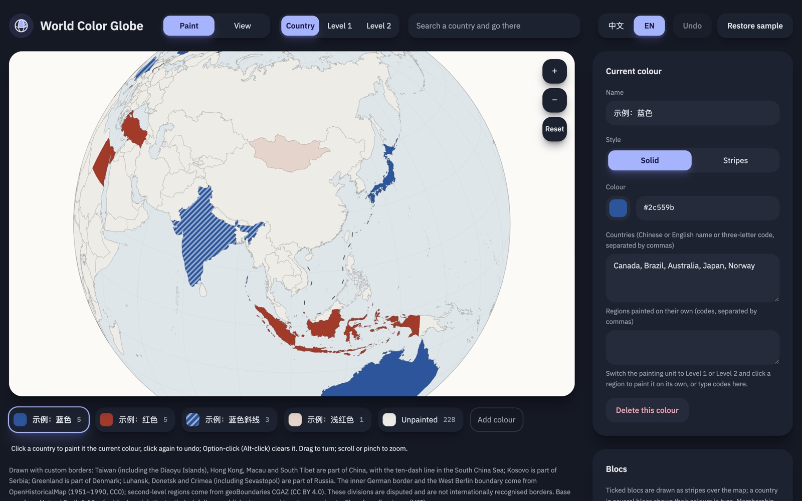
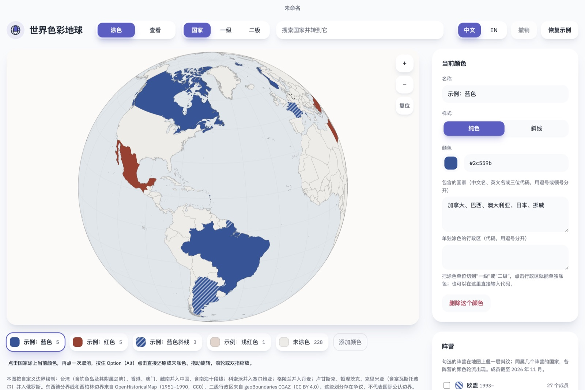

# 世界色彩地球 · World Color Globe

一个可以拖动旋转、缩放的世界地球，能按国家、一级行政区（省、州）或二级行政区（市、县）分别上色，点国家可以打开它的平面地图。有网页版和 macOS 桌面版，两者共用同一份前端代码。

An interactive globe for colouring countries, states and counties, with per-country flat maps, bloc overlays and a Chinese / English interface. Web build plus an Electron app for macOS.



## 能做什么

### 转、找、放大

拖动可以旋转，有惯性；滚轮、双指或右上角的按钮可以缩放，最大 10 倍。方向键也能旋转，回车会对画面正中央的国家执行当前操作。

顶部的搜索框可以输入中文名、英文名或三位代码。选中后，地球会转到这个国家的首都，并放大到整个国家大致占满画面。这里只算首都所在的那片国土，以及离首都不比本土最远处远太多的岛屿，所以美国不算阿拉斯加，丹麦不算格陵兰。梵蒂冈、新加坡这样的小国会直接放大到 10 倍；距离较远时，途中会先拉远再拉近。



### 涂色

顶部有“涂色 / 查看”两种模式，以及“国家 / 一级 / 二级”三种涂色单位。涂色模式下，点一下给当前单位上色，再点一次取消。选一级或二级时，鼠标停在国家上会显示它的行政区界线，以及所指区域的名称和代码。不管当前用的是哪支画笔，按住 Option（Windows 上是 Alt）点击，都会把这个单位直接还原。

每种颜色可以设置名称、纯色或斜线、颜色值，行政区的颜色会盖过国家的颜色。右侧可以直接输入国家名或行政区代码来批量上色，找不到的条目会单独列出。

二级行政区的代码是“国家代码-编号”，比如芝加哥所在的库克县是 `USA-0628`。编号在每个国家内按名称排序生成，底层数据不变，代码就不会变。全世界共 49,340 个，没有重复。一级行政区的代码写成 `USA.US-CA` 这样。

### 平面图

查看模式下点国家，会打开它的平面图。美国用 Albers USA 投影，带阿拉斯加和夏威夷插图；其他国家用按国家范围自动设参数的 Albers 等积圆锥投影，南极洲用极地等积投影。远离本土的领土放进底部的小插图，最多 6 个；中国平面图右下角有南海小图。平面图最大可以放大 12 倍，放大后会显示更多行政区名称。

下图给德国东部 7 个一级行政区单独上了色。德国的行政区沿 1951–1990 年的东西德分界线对齐过，涂色边缘正好落在分界线上，柏林也拆成了西柏林和东柏林。



### 阵营和国旗

右侧“阵营”里可以勾选欧盟、北约、华约、集安组织、东盟、欧佩克、美洲国家组织和不结盟运动。勾上的阵营会在地图上叠一层斜纹，同属几个阵营的国家各色轮流出现。展开可以看成员的国旗、成员状态和已退出的成员，还能一键把成员涂成当前颜色。华约按当年的地域显示：苏联取 15 个继承国，东德取德国东部各州。



### 中英文和主题

顶栏可以切换中文和英文，按钮、提示、国家名、行政区名、平面图标注和导出的图都会跟着换。“底图”里可以选跟随系统、浅色或深色主题。主题只改界面，不改地图本身的颜色。



### 导出、备份和导入

当前视图可以导出成 PNG 或 SVG，也可以复制 SVG 代码。底图可以开关一级和二级行政区线、行政区名称（字号 7–20 像素）、经纬网，以及东西德分界线和西柏林边界；海洋、背景和未涂色国家的颜色都可以改。

配色的保存方式要看用的是哪个版本：

- **网页版**每次修改都会自动存进浏览器的本地存储，但只在这一个浏览器里，清除网站数据就没了。要备份，就展开右下角的“配置 JSON（备份或导入）”，复制里面的内容存成 `.json` 文件。恢复时点“导入 .json 文件”，或者把内容粘回去后点“应用”。撤销最多 60 步，刷新页面后清空。
- **桌面版**把配色存在你自己保存的 `.json` 项目文件里，“文件”菜单里有新建、打开、保存、另存为和最近打开。两边的格式相同，网页版存下来的 `.json` 可以直接用桌面版打开。

导出的 PNG 和 SVG 只是图片，不能用来恢复配色。

### 桌面版

桌面版是同一份页面套上 Electron 外壳，可以完全离线使用：地图数据、脚本和字体都打包在程序里，页面有严格的内容安全策略，不会访问外网。macOS 上隐藏了系统标题栏，窗口顶部那条显示文件名，有未保存的修改时会加一个 ●。



## 边界设定

这张图按自定义边界绘制，不代表国际公认边界，也不等同于任何一国的官方立场，页面底部写有说明。底图以 Natural Earth 的中国视角数据为基础，再做了以下改动：

- 台湾、香港、澳门、藏南并入中国，藏南归入西藏；南海画十段线，放在中国平面图的小图里。
- 钓鱼岛及其附属岛屿（钓鱼岛、黄尾屿、赤尾屿等 9 块）归中国，在一级行政区里属于台湾省。Natural Earth 的一级数据原本把它们划在日本冲绳县，国家轮廓里也缺了黄尾屿和赤尾屿，现在两级一致。
- 科索沃并入塞尔维亚，格陵兰并入丹麦。丹麦平面图以本土为主图，格陵兰放进插图。
- 卢甘斯克、顿涅茨克、克里米亚（含塞瓦斯托波尔）并入俄罗斯。这一项与中国的官方立场不一致，所以页面上写的是“自定义边界”。
- 五大湖等跨国大湖做成镂空。
- 柏林拆成西柏林和东柏林两个行政区。
- 德国的一级和二级行政区沿东西德分界线（1951–1990）对齐。诺伊豪斯（Amt Neuhaus，易北河东岸，1945–1990 年属东德，1993 年起属下萨克森）单独成为一个行政区：一级代码 `DEU.DE-NI-AN`，二级代码 `DEU-0040`。所以给今天的整个下萨克森涂色时，这一块要单独再点一下。

导出的图片和 SVG 里不带这段说明，单独分享时要自己注明。在中国公开发布地图通常要送审并取得审图号，这版边界不能当作标准地图使用。

## 数据来源

| 内容 | 来源 | 许可 |
|---|---|---|
| 国家轮廓、一级行政区、湖泊、前九段线 | Natural Earth 1:10m 5.1.1（含中国视角版本） | 公有领域 |
| 二级行政区 | geoBoundaries CGAZ ADM2 | CC BY 4.0 |
| 东西德分界线、西柏林边界（1951–1990） | OpenHistoricalMap 关系 2692241 | CC0 |
| 各国首都（搜索时转到的位置） | Natural Earth 1:10m 有人口地区，另有 19 个小领地是手工补的 | 公有领域 |
| 国旗 | flag-icons | MIT |
| 第十段线的位置 | 参考阿里云 DataV 地理数据，只是近似 | 条款未核实 |

地图数据不放在仓库里，用下面的脚本下载、生成。

## 运行和构建

需要 Node.js（开发时用的是 24）、约 300MB 磁盘空间，以及本机的 Google Chrome（只有测试和截图要用）。第一次使用时按顺序运行：

```sh
npm install
npm run fetch          # 下载原始数据到 raw/，约 220MB
npm run prepare-data   # 生成中间文件
npm run build          # 生成 dist/data 和 dist/index.html，约 20 秒
npm run serve          # 本地预览：http://127.0.0.1:8765/wrap.html
```

只改了 `src/` 里的文件时，运行 `npm run assemble` 就够了，它会同时生成网页版和桌面版的页面。改了数据处理规则，要从 `npm run build` 开始重跑。

桌面版：`npm run desktop` 直接启动，`npm run dist:mac` 打包 Apple Silicon 版的 dmg 和 zip（各约 125MB，其中 50MB 是地图数据），输出到 `release/`。目前还没有签名和公证，复制到别的 Mac 上第一次打开时，要右键选择“打开”，或者在“系统设置 › 隐私与安全性”里放行。

README 里的截图由 `node scripts/screenshots.mjs <globe|search|germany|blocs|dark>` 生成，需要先运行 `npm run serve`。桌面版那张是手动截的。

## 实现方式

地球用 WebGL2 和正射投影绘制，拖动和静止都是 1:10m 精度，三种拖动情况都稳定在 60 帧；浏览器不支持 WebGL2 时退回 Canvas 2D。悬停高亮画在一层 Canvas 2D 上，平面图用 SVG 绘制，方便导出。读数据、保存文件和读写配置都经过 `src/platform.js`，网页版和桌面版各有一套实现。用到的库有 D3 7.9.0、TopoJSON 和 earcut 2.2.4。

简化后的国家轮廓直接嵌在页面里。1:10m 轮廓、行政区线，以及每个国家的一级（210 个文件）和二级（201 个文件）行政区数据是单独的文件，打开对应国家时才加载，总共约 50MB。

数据用 mapshaper 处理，主要步骤是：

1. 以中国视角的国家数据为底，把顿巴斯和克里米亚从乌克兰切出、并入俄罗斯，合并港澳、黄岩岛、格陵兰等单位，再扣掉跨国湖泊。
2. 用带湖泊镂空的一级行政区数据，按上面的设定重新分配归属，并用西柏林边界把柏林切成两半。
3. 德国的一级、二级行政区用 OpenHistoricalMap 的东德多边形对齐（`scripts/gdr-align.mjs`）：每个行政区保留大部分面积所在的一侧，贴着分界线、落在另一侧的碎块交给另一侧共享边界最长的邻区。诺伊豪斯从二级数据里切出来，在两级里都单独成块。
4. 二级行政区默认沿用数据自带的国家归属，只有乌克兰、印度、美国、芬兰、澳大利亚、塞浦路斯、台湾、科索沃这些有争议或分属不同单位的地方，才按重叠面积重新判断。原始数据的文字编码是混杂的，名称要逐条按 UTF-8 或 Latin-1 解码。

WebGL 改造、桌面版、帧率测试和各版本的细节见 [开发记录](docs/DEVLOG.md)。

## 目录

```
src/globe.html       页面模板，__GEO__ 处会填入内嵌数据
src/globe-gl.js      WebGL 地球：球面三角化、着色器和绘制
src/platform.js      平台接口层：网页版和桌面版的读数据、保存文件、读写配置
src/i18n.js          中英文界面文字
src/blocs.js         阵营和成员（截至 2026 年 11 月）
src/capitals.js      各单位的首都坐标，由 scripts/capitals.mjs 生成
desktop/             Electron 外壳：main.mjs（主进程、菜单、app:// 协议）、preload.cjs
design/logo/         标志：生成脚本、导出脚本、使用说明 GUIDE.md，成品在 kit/
docs/                开发记录和 README 截图
scripts/             数据下载、处理、组装、截图和本地预览脚本
  fetch-data.sh        下载原始数据到 raw/
  prepare.sh           从原始数据生成中间文件
  build.sh             生成 dist/data，并组装出 dist/index.html
  capitals.mjs         从 Natural Earth 生成 src/capitals.js
  flags.mjs            把 flag-icons 的国旗按地图单位打包成 dist/data/flags.json
  gdr-align.mjs        把德国行政区和东西德分界线对齐，切出诺伊豪斯
  assemble.mjs         组装 dist/index.html 和 desktop/app/
  screenshots.mjs      生成 README 截图
  serve.mjs            本地预览
test/                用 puppeteer-core 驱动本机 Chrome 和 Electron 的测试
  interactions.mjs     涂色、代码输入、旧配置迁移
  denmark.mjs          平面图插图
  webgl.mjs            WebGL 显示、点击、悬停、缩放、导出、阵营和中英文（分批运行）
  desktop.mjs          桌面版：项目文件、菜单、导出、内容安全策略
  bench.mjs            拖动帧率
  mesh.mjs             在 Node 里检查球面三角化
```

`raw/`、`work/`、`dist/`、`release/` 和 `desktop/app/` 都是生成的，不进 git。

## 已知问题

- 一级和二级行政区来自不同数据源，放大后边界对不齐。德国沿东西德分界线的一段已经对齐，其他地方照旧。
- 二级行政区只有原文名，没有中文，比如中国的区县显示为拼音。
- 地球上只显示鼠标所在国家的区县界线，不显示全球的区县线。
- 日本平面图的插图其实是南鸟岛，但标成了“东京”，形状也被放大了上千倍。
- 西施塔肯在 1951–1990 年属于东德，所以被划进了东柏林；施泰因施蒂肯这类西柏林飞地，在数据里只是边界上的一个小凸起。
- 法罗群岛在数据里仍是独立单位，还没有并入丹麦。
- 测试都在本机的 Chrome 和 Electron 里做，双指缩放、触屏设备、120Hz 屏幕和其他显卡还没有测过。网页版的“保存 PNG/SVG”按钮依赖 claude.ai 页面提供的下载能力，在普通浏览器里会隐藏，只能用“复制 SVG 代码”。
- 桌面版还没有签名和公证；`.json` 也没有注册成这个应用的文件类型，要在应用里用“打开”，或者把文件拖到程序坞图标上。

## 计划

- **对齐一级和二级行政区边界。** 推荐用二级行政区合并出一级行政区，两层边界就能完全重合，中文名和 `US-CA` 这类代码沿用 Natural Earth，已经涂过的颜色不会丢。更彻底的做法是把国家轮廓也换成同一来源，但之前的边界调整都要重做。
- **更精细的海岸线。** 可以用 OpenStreetMap 的陆地多边形，放大到某个国家时再按需加载；陆上国界保持不变，只替换沿海部分。要配合把最大缩放提高到 30–50 倍，才看得出差别。
- **小修补。** 修好南鸟岛插图；决定法罗群岛是否并入丹麦；视需要给二级行政区补中文名；桌面版签名和公证。
